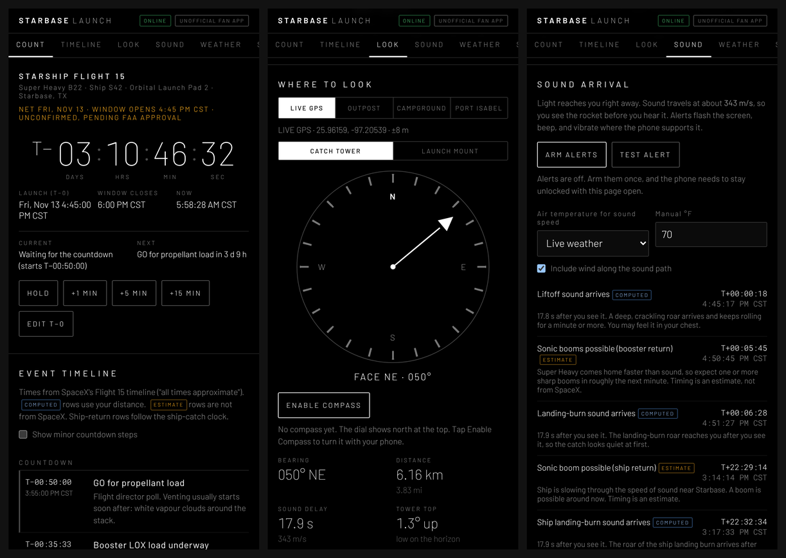

# StarbaseLaunchApp

**A launch-day companion for Starship Flight 15 at Starbase, Texas.** Keep it open on your phone at the viewing site. It runs the countdown, shows each flight event as it happens, points you at the tower, and warns you a few seconds before the roar reaches you.

> **Unofficial fan app.** It isn't affiliated with or endorsed by SpaceX or Rocket Ranch. All times are approximate and change often, so always go by official SpaceX updates and on-site staff.

## What's on the screen

The tabs at the top jump between six sections.

### Count
A big **T−** clock counts down to liftoff and turns into a green **T+** clock after launch. Times are shown in **Central Time (CST)**, the local time at Starbase.

- The orange line under the mission name tells you whether the time is still **NET** ("no earlier than") and unconfirmed, or a time you set yourself.
- **CURRENT / NEXT** show the latest event and how long until the next one.
- Launch times move all the time, so you can adjust it yourself:
  - **HOLD** freezes the clock, just like a hold in the real count. **RESUME COUNT** picks up again, and everything after it shifts back by the length of the hold.
  - **+1 / +5 / +15 MIN** handle a quick slip.
  - **EDIT T−0** lets you type the exact new liftoff time in Central Time. **RESET TO SPACEX TARGET** puts back the published window-open time.

Your settings are saved on the phone, so they stay put if you close the page.

### Timeline
Every event from SpaceX's published Flight 15 timeline, from the GO for propellant load at T−50 minutes through the booster catch at about T+6:35 and the ship catch the next day. Each row shows its T-time, the clock time, and **what you'll actually see or hear from the ground**. The current event is highlighted as the clock runs.

Some rows carry tags:

| Tag | Meaning |
| --- | --- |
| *(none)* | From SpaceX's timeline. SpaceX marks these "all times approximate." |
| `COMPUTED` | Worked out from your own distance to the pad, like when the sound arrives. |
| `ESTIMATE` | Not from SpaceX, such as when sonic booms might be heard. Treat these as rough guides. |
| `WEBCAST` | Happening too far away to see. Follow along on the SpaceX webcast. |

Tick **Show minor countdown steps** to see every propellant-loading call.

### Look
Shows where to point your eyes.

- **LIVE GPS** uses your phone's location, so distances are right wherever you're standing. If GPS isn't available, pick a preset: the **Rocket Ranch Outpost** (the launch viewing site), the **Rocket Ranch Campground**, or **Port Isabel**.
- Choose the **CATCH TOWER** or the **LAUNCH MOUNT** as your target. They're about 50 m apart.
- The arrow on the dial points to the target. Tap **ENABLE COMPASS** (iPhone will ask for permission) and the dial turns with your phone, telling you **TURN LEFT / TURN RIGHT** until you're **ON TARGET**. Without a compass, north stays at the top and you can line up using the bearing.
- The readouts show the **bearing**, the **straight-line distance**, the **sound delay**, and how high the top of the tower sits above the horizon. From the Outpost the tower is only about 1.3° up, so look low.
- The sun's position (☀ on the dial) gives you a quick reference if your compass is acting up.

From the Rocket Ranch Outpost, the tower is about **050° (northeast), 6.2 km / 3.8 mi away**, and the sound takes about **18 seconds** to reach you.

### Sound
At this distance you **see** liftoff long before you **hear** it. The app works out when the sound reaches you:

**delay = distance ÷ speed of sound**

The speed of sound comes from the live air temperature, roughly 343 m/s at 20 °C (68 °F), and is nudged by the wind blowing along the path. You can switch to a manual temperature if you like.

Tap **ARM ALERTS** once. At each sound moment (the liftoff roar, possible booster sonic booms, the landing-burn roar, and the same again for the ship catch), the app flashes the whole screen, sounds a tone, reads the event aloud, and vibrates. For the computed sound arrivals it also gives three short beeps just before. Tap **TEST ALERT** to try it out.

- **iPhone:** Safari doesn't support vibration from websites, so you'll get the flash, tone, and voice. Turn the volume up.
- Keep the page open and the screen unlocked. The app asks the phone to keep the screen awake where it can.

### Weather
Live conditions at the pad from [Open-Meteo](https://open-meteo.com/): temperature, wind speed and direction, gusts, cloud cover, visibility, humidity, and sunset time. There's also a forecast for the launch time and the ship-catch time. If you lose signal, it shows the last reading and marks it **CACHED**. This is regular weather data, not SpaceX's launch weather call.

### Ship catch
A second countdown for the ship's return the next day. By default it's **T−0 + 22:32:34**, from SpaceX's timeline, and it moves with the launch clock. Untick **Follow launch time** to set it yourself. SpaceX will only bring the ship back to the tower if it's healthy. Otherwise it comes down in the ocean, so this is a planned catch, not a sure thing.

## Works without signal

Cell service near Starbase gets patchy, and big crowds make it worse. After you open the site once online, your phone keeps a copy and the app runs fully offline. The countdown, timeline, compass, GPS, and alerts all keep working, and weather shows the last reading.

**Install it to your home screen** for a full-screen app:
- **iPhone (Safari):** Share → *Add to Home Screen*
- **Android (Chrome):** ⋮ menu → *Add to Home screen* / *Install app*

## Where the numbers come from

| What | Value used | Source |
| --- | --- | --- |
| Launch window | Fri Nov 13, 2026, opens 4:45 PM CST (22:45 UTC), 75 minutes long. NET, pending FAA approval | [SpaceX Flight 15 page](https://www.spacex.com/launches/starship-flight-15) |
| Flight timeline | SpaceX's published Flight 15 countdown and flight timeline | [SpaceX Flight 15 page](https://www.spacex.com/launches/starship-flight-15) |
| Launch mount, Pad 2 | 25.996603° N, 97.158251° W | [Launch Library 2](https://ll.thespacedevs.com/2.2.0/pad/235/) |
| Catch tower, Pad 2 | 25.99705° N, 97.15807° W (traced from OpenStreetMap, ±tens of m), about 144.5 m tall | [Starship Catch Simulator site notes](https://dionismuzenitov.github.io/starship-catch-sim/docs/kb/starbase-catch-site-pad-a-b-dimensions-and-catch-history) |
| Rocket Ranch Outpost | 25.96159° N, 97.20539° W (about 3.8 mi from the pad; Rocket Ranch says ≈3.7 mi) | [Visit Starbase](https://visit-starbase.com/watch/rocket-ranch), [Rocket Ranch FAQ](https://rocketranchstarbase.com/faq/) |
| Rocket Ranch Campground | 25.947229° N, 97.279813° W (43742 Palmito Hill Rd) | [Campendium](https://maps.campendium.com/us/brownsville-tx/camping-rv/rocket-ranch-boca-chica) |
| Port Isabel | 26.07341° N, 97.20858° W (town centre) | [OpenStreetMap](https://www.openstreetmap.org/relation/114514) |
| Sonic booms | Possible during both returns. Exact timing not published, so the app's times are estimates | [KRGV](https://www.krgv.com/news/spacex-sets-target-date-for-15th-starship-launch-at-starbase) |

## How it works

- **Distance and bearing** use the great-circle (haversine) formula on a spherical Earth. Over 6 km this matches a full WGS-84 ellipsoid calculation to within about 3 m and 0.2°.
- **Speed of sound** is 331.3 × √(1 + T/273.15) m/s, with T in °C, plus the wind component along the path from the pad to you.
- **Tower elevation** accounts for Earth's curvature and normal atmospheric refraction.
- **Compass** reads the phone's orientation sensor: `webkitCompassHeading` on iPhone, absolute device orientation on Android. Phone compasses can be off by several degrees, especially near cars or metal, so wave the phone in a figure-8 to recalibrate.
- Everything runs in your browser. Nothing is sent anywhere except the weather request to Open-Meteo. Your location never leaves your phone.

## Using it on a computer

Open `index.html` in a browser, or visit the hosted site. Offline mode needs the hosted (https) version.

## License

MIT © 2026 Luke de Wet. See [LICENSE](LICENSE).

Starship and SpaceX are trademarks of Space Exploration Technologies Corp. This project is an independent fan project and uses no SpaceX logos.
